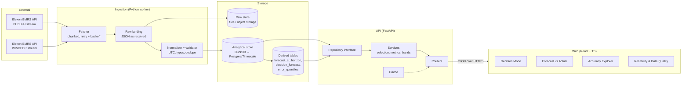
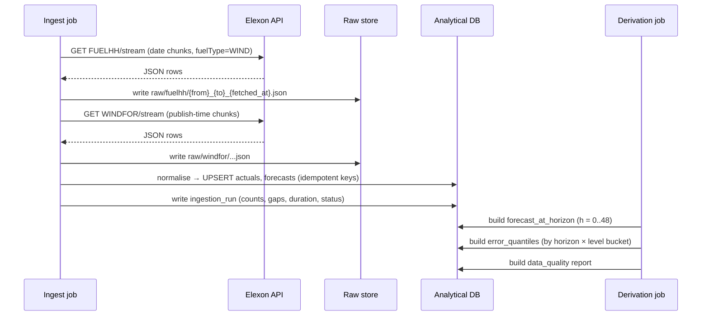
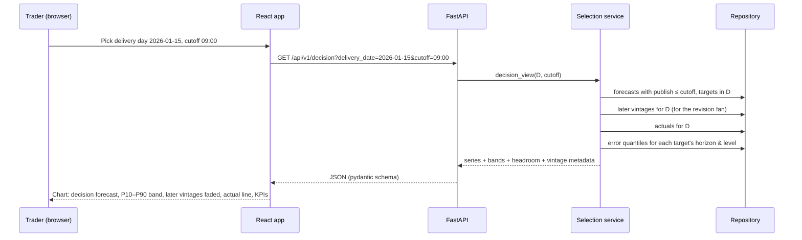
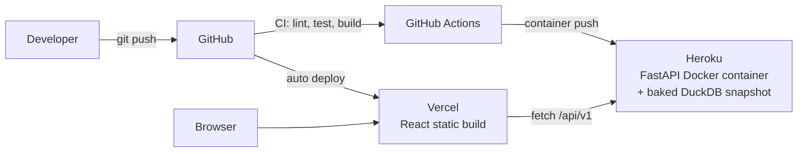
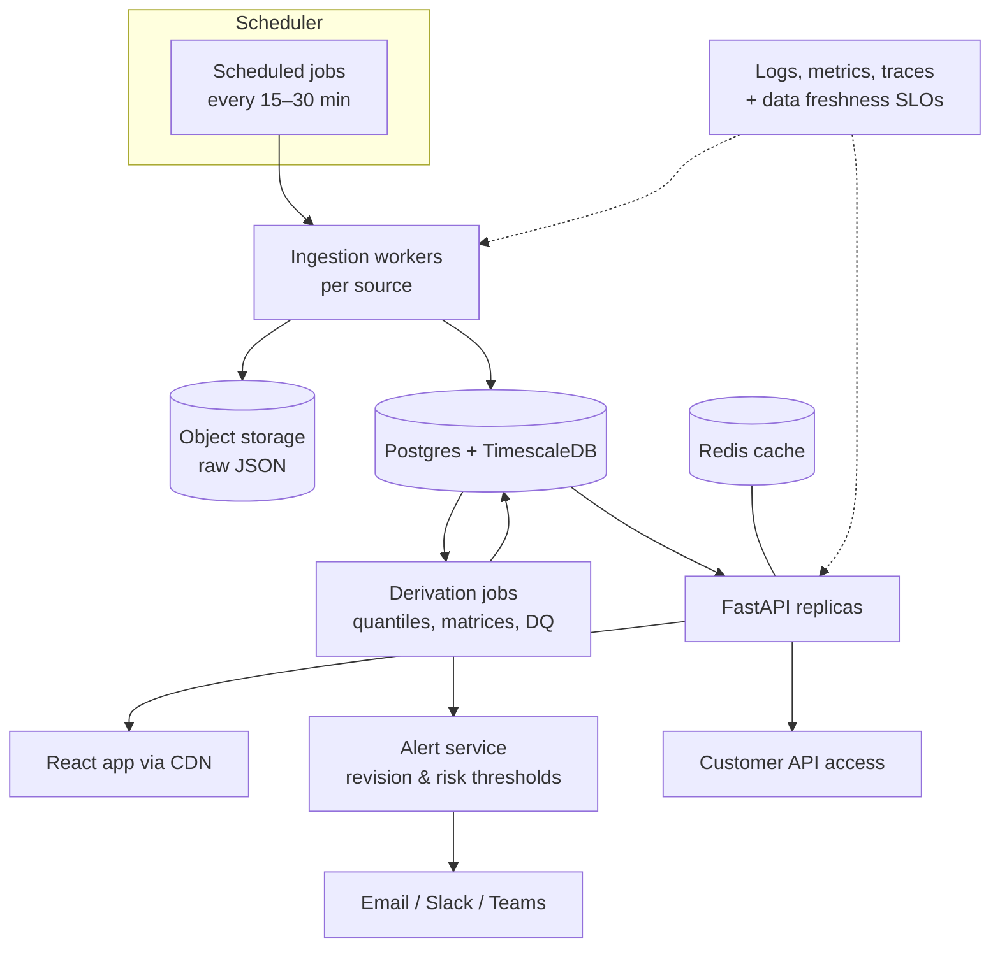

# Headroom — Wind Forecast Risk Desk for Day-Ahead Power Buyers

> **One line:** Headroom shows a UK day-ahead buying desk *exactly what the wind forecast said at the moment they had to decide*, how wrong that forecast has historically been at that horizon, and how many MW of "headroom" that error implies they should plan for.

This document is the end-to-end design: product thinking, architecture, data flow, algorithms, API, UI, engineering practices, a 16-hour build plan for the REint challenge, and the roadmap from pilot to a product people pay for.

---

## 0. TL;DR

| | |
|---|---|
| **Challenge asks for** | React + Python web app showing UK national wind forecasts (Elexon `WINDFOR`) vs actuals (Elexon `FUELHH`, `fuelType=WIND`) and quantifying forecast accuracy, for purchase decisions made in January 2026. Docker, deployed on Vercel/Heroku. |
| **What most submissions will build** | A line chart of forecast vs actual with a horizon slider, plus MAE/RMSE. |
| **What Headroom adds** | (1) **Point-in-time "Decision Mode"** — reconstructs the forecast exactly as it stood at the desk's cutoff on D-1, with zero look-ahead. (2) **Calibrated uncertainty bands** (P10/P50/P90) built from the forecast's own historical errors, with honest backtested coverage. (3) **Error explorer** that answers *when* the forecast fails (horizon, hour of day, wind level, ramps). (4) **Skill vs a naive baseline** so accuracy numbers mean something. |
| **Why someone pays** | Every MW of over-forecast wind is a MW the desk under-buys and then settles in imbalance, usually at a worse price. Turning a single-number forecast into "plan for P90 shortfall of X MW" is directly tied to money. |
| **Stack** | FastAPI + DuckDB/pandas (Python), React + TypeScript + Vite + ECharts, Docker Compose, GitHub Actions, frontend on Vercel, API container on Heroku. |
| **Scale path** | Same code, swap DuckDB snapshot → Postgres/TimescaleDB, add scheduled ingestion workers, multi-tenant portfolios, alerts, and a "bring your own forecast" benchmarking module. |

---

## 1. The problem, as the desk actually experiences it

The PM brief says the team must (a) understand the latest renewable forecast available when they decide, and (b) evaluate that forecast's accuracy quantitatively.

The subtle point most tools get wrong: **"the latest forecast" is not a fixed thing.** Elexon republishes `WINDFOR` several times a day. For any delivery half-hour there are many forecast *vintages*, each with a different `publishTime`. If you evaluate accuracy using the most recent forecast before delivery, you are grading a forecast the buyer never had when they placed their bids. That makes the forecast look better than it was for the decision that mattered, and the desk under-estimates its risk.

So the two questions the desk really has are:

1. *"For tomorrow, what does the forecast say, as of my cutoff, and how much has it been moving?"*
2. *"When the forecast looked like this, at this lead time, how wrong was it, in which direction, and how often badly?"*

Headroom is designed around those two questions.

### 1.1 Interpreting "decisions made in January 2026"

A day-ahead decision made on day D-1 is for delivery day D. Decisions made between 1 and 31 January 2026 therefore cover **delivery days 2 January → 1 February 2026**. The app should:

- use forecasts **published** up to the January 31 cutoff,
- use actuals for target times through the end of 1 February 2026,
- state this interpretation explicitly in the UI and README (it shows domain understanding, and a reviewer can change one config value if they disagree).

---

## 2. Product definition

### 2.1 Users and buyers

| Persona | Need | Uses Headroom for |
|---|---|---|
| **Day-ahead trader / buyer** | Decide volume to procure before the auction | Decision Mode, P90 shortfall, revision alerts |
| **Desk lead / risk manager** | Understand systematic exposure | Error explorer, bias, worst-miss reports |
| **Forecasting / analytics lead** | Choose and trust forecast sources | Benchmarking, skill scores, calibration |

**Who pays first:** small and mid-size UK suppliers, independent aggregators, and flexible-asset (battery) operators who trade day-ahead but don't run an in-house quant forecasting team. The large suppliers often build this internally; the mid-market rarely has the time.

### 2.2 What is genuinely new here (and what isn't)

Being honest about this matters both in the pitch and in customer discovery:

- **Not new:** displaying wind forecasts and outturn. BMRS already does this, and commercial vendors sell forecasts.
- **Less common, and the wedge:** *point-in-time* evaluation keyed to the customer's own decision cutoff, plus *calibrated uncertainty* derived from a public deterministic forecast's track record, presented as a procurement number ("headroom MW") rather than a statistic.
- **The longer-term moat:** a neutral **forecast benchmarking** layer. Suppliers often pay for one or more forecast vendors and have no rigorous, look-ahead-free way to compare them. Headroom evaluates any forecast source the same way it evaluates `WINDFOR`.

Treat "nobody does this" as a hypothesis to validate in discovery calls, not a claim to put in the pitch.

### 2.3 Feature tiers

| Feature | Challenge MVP (16h) | Pilot | Paid product |
|---|:-:|:-:|:-:|
| Forecast vs actual chart, date range + horizon slider | ✅ | ✅ | ✅ |
| Accuracy metrics (MAE, RMSE, bias, P90 abs error, nMAE) | ✅ | ✅ | ✅ |
| **Decision Mode** (forecast as of configurable D-1 cutoff + later vintages) | ✅ | ✅ | ✅ |
| Error by horizon / hour-of-day / wind level | ✅ | ✅ | ✅ |
| **P10–P90 bands + backtested coverage** | ✅ (simple) | ✅ | ✅ |
| Skill vs persistence baseline | ⭐ stretch | ✅ | ✅ |
| Worst-miss table & ramp-event errors | ⭐ stretch | ✅ | ✅ |
| Data-quality panel (gaps, stale forecast at cutoff) | ✅ (basic) | ✅ | ✅ |
| Scheduled live ingestion | — | ✅ | ✅ |
| Revision alerts (email/Slack/Teams) | — | ✅ | ✅ |
| Solar, embedded generation, demand → residual demand | — | — | ✅ |
| Customer portfolio scaling & imbalance cost estimates | — | — | ✅ |
| Bring-your-own-forecast benchmarking | — | — | ✅ |
| API access / CSV export | basic CSV | ✅ | ✅ |

The challenge restricts data to Elexon national wind, so every MVP feature above is built from `FUELHH` + `WINDFOR` only.

---

## 3. Core concepts and definitions

Getting the vocabulary precise up front avoids most bugs.

| Term | Definition |
|---|---|
| **Target time** `t` | `startTime` of the delivery period being forecast. Stored in UTC. |
| **Publish time** `p` | When a forecast vintage was created (`publishTime`). |
| **Vintage** | All forecast rows sharing one `publishTime`. |
| **Horizon** `h` | `t − p`, in hours. |
| **Horizon-h forecast for t** | The forecast from the **latest** vintage with `p ≤ t − h`. If none exists, the value is missing (never fall forward to a later vintage). |
| **Decision cutoff** `c(D)` | Configurable local time on D-1 (default `09:00 Europe/London`; set it to the desk's real internal deadline). |
| **Decision forecast for t ∈ D** | The forecast from the latest vintage with `p ≤ c(D)`. Horizons then vary by hour, which is realistic. |
| **Forecast age at cutoff** | `c(D) − p` of the vintage used. Large values mean the desk decided on a stale forecast. |
| **Error** `e` | `forecast − actual` (MW). **Positive = over-forecast = wind shortfall = buyer is short.** This sign is chosen deliberately because it is the costly direction for a buyer. |

### 3.1 Metrics

| Metric | Formula | Why |
|---|---|---|
| Bias (ME) | mean(e) | Systematic over/under-forecasting |
| MAE | mean(\|e\|) | Robust headline error in MW |
| RMSE | sqrt(mean(e²)) | Penalises big misses |
| P50 / P90 / P99 \|e\| | quantiles of \|e\| | "How bad is a bad day" |
| nMAE | MAE / mean(actual) | Comparable across periods. Avoid MAPE: it explodes at low wind. |
| Shortfall P90 | 90th pct of max(e, 0) | The procurement-relevant number |
| Skill score | 1 − MAE_forecast / MAE_baseline | Shows the forecast actually adds value over a naive baseline |
| Interval coverage (PICP) | share of actuals inside [P10, P90] | Should be close to 80% if bands are calibrated |
| Pinball loss | standard quantile loss | Scores the bands themselves |

---

## 4. System architecture

### 4.1 Component view



### 4.2 Design principles

1. **Point-in-time correctness is a core invariant, not a feature.** Every query that selects a forecast takes a cutoff and can only see vintages published at or before it. This is unit-tested directly.
2. **Raw data is immutable; everything else is rebuildable.** If the selection logic changes, re-derive from raw. Never patch derived tables by hand.
3. **Pure analytics core.** Selection, metrics and banding are pure functions on dataframes. No I/O, no web framework. This makes them trivially testable and reusable in notebooks, the API and batch jobs.
4. **Ports and adapters for storage.** A `Repository` interface with a `DuckDBRepository` for the challenge and a `PostgresRepository` later. Business logic never imports a database driver.
5. **Precompute what's cheap, compute on demand what's parametric.** The full `target × horizon (0–48h)` matrix is small and precomputed. User-chosen date ranges and cutoffs are computed on request.
6. **UTC everywhere internally; Europe/London only at the edges** (cutoff definition and UI display). January has no DST change, but the code should not depend on that, because the product will run all year.

### 4.3 Why these technology choices

| Choice | Reason | Alternative considered |
|---|---|---|
| **FastAPI** | Typed request/response models with pydantic, automatic OpenAPI docs (great for the tech-lead review), async-friendly | Flask (less typing support), Django (too heavy) |
| **DuckDB** (MVP) | In-process, zero ops, fast columnar SQL, native `ASOF JOIN` that maps exactly to "latest vintage before cutoff", reads Parquet | Postgres (needs a paid add-on on Heroku for a tiny dataset) |
| **Postgres + TimescaleDB** (product) | Multi-user writes, continuous ingestion, hypertables for time series, mature hosting | ClickHouse (great at scale, overkill early) |
| **pandas** | Familiar to reviewers; `merge_asof` mirrors the SQL | Polars (faster, but less familiar to reviewers) |
| **React + TS + Vite** | Required React; TS catches API contract drift; Vite is fast | CRA (deprecated) |
| **ECharts** | Native confidence-band areas, large series, zoom/brush, good performance | Recharts (bands are awkward), Plotly (heavier bundle) |
| **TanStack Query** | Caching, loading/error states, request de-duplication for slider-driven requests | Hand-rolled `useEffect` fetching |

---

## 5. End-to-end data flow

### 5.1 Ingestion and derivation



### 5.2 User request flow (Decision Mode)



### 5.3 Ingestion details that matter

- **Endpoints** (verify exact parameter names in the Elexon docs before coding):
  - Actuals: `https://data.elexon.co.uk/bmrs/api/v1/datasets/FUELHH/stream` with settlement-date range and `fuelType=WIND`.
  - Forecasts: `https://data.elexon.co.uk/bmrs/api/v1/datasets/WINDFOR/stream` with a publish-time range.
- **Window to fetch:** forecasts published from late December 2025 (so early-January targets have long-horizon vintages) to 1 February 2026; actuals for 1 January → 2 February 2026. Filter to the analysis window afterwards; over-fetch slightly rather than miss edge vintages.
- **Chunking:** request by day or week, so one failed call doesn't lose the month, and retries are cheap.
- **Retries:** exponential backoff with jitter on 429/5xx; fail loudly on 4xx other than 429.
- **Idempotent upserts:** actuals keyed on `target_time` (keep the latest `publish_time` if revised); forecasts keyed on `(target_time, publish_time)`.
- **Resolution mismatch:** `FUELHH` is half-hourly. `WINDFOR` may be at a coarser resolution. Inspect on first ingest. If forecasts are hourly, compare only at target times where both exist (simplest and honest), and document it. Do not interpolate forecasts silently.
- **Scope consistency:** confirm that the `FUELHH` WIND series and `WINDFOR` describe the same population (e.g., transmission-metered wind). If they differ, the "error" partly measures a definitional gap, and the UI must say so.

---

## 6. Data model

### 6.1 Tables

```sql
-- Immutable record of every ingestion run
CREATE TABLE ingestion_run (
    run_id          UUID PRIMARY KEY,
    dataset         TEXT NOT NULL,          -- 'FUELHH' | 'WINDFOR'
    window_from     TIMESTAMPTZ NOT NULL,
    window_to       TIMESTAMPTZ NOT NULL,
    started_at      TIMESTAMPTZ NOT NULL,
    finished_at     TIMESTAMPTZ,
    rows_received   INTEGER,
    rows_upserted   INTEGER,
    status          TEXT NOT NULL,          -- 'ok' | 'partial' | 'failed'
    error           TEXT
);

-- Actual wind generation (half-hourly)
CREATE TABLE actual_generation (
    target_time       TIMESTAMPTZ PRIMARY KEY,   -- startTime, UTC
    settlement_date   DATE NOT NULL,
    settlement_period SMALLINT NOT NULL,
    generation_mw     DOUBLE PRECISION NOT NULL,
    source_publish_time TIMESTAMPTZ,             -- if provided by API
    ingested_at       TIMESTAMPTZ NOT NULL,
    run_id            UUID REFERENCES ingestion_run
);

-- Every forecast vintage
CREATE TABLE forecast_generation (
    target_time    TIMESTAMPTZ NOT NULL,
    publish_time   TIMESTAMPTZ NOT NULL,
    generation_mw  DOUBLE PRECISION NOT NULL,
    horizon_h      DOUBLE PRECISION GENERATED ALWAYS AS
                   (EXTRACT(EPOCH FROM target_time - publish_time) / 3600) STORED,
    ingested_at    TIMESTAMPTZ NOT NULL,
    run_id         UUID REFERENCES ingestion_run,
    PRIMARY KEY (target_time, publish_time)
);
CREATE INDEX ON forecast_generation (target_time, publish_time DESC);

-- Derived: forecast at each integer horizon (rebuildable)
CREATE TABLE forecast_at_horizon (
    target_time    TIMESTAMPTZ NOT NULL,
    horizon_h      SMALLINT NOT NULL,           -- 0..48
    publish_time   TIMESTAMPTZ,                 -- NULL if no vintage qualifies
    generation_mw  DOUBLE PRECISION,
    PRIMARY KEY (target_time, horizon_h)
);

-- Derived: empirical error quantiles for bands
CREATE TABLE error_quantiles (
    horizon_bucket  TEXT NOT NULL,     -- e.g. '0-6','6-12','12-24','24-36','36-48'
    level_bucket    TEXT NOT NULL,     -- forecast MW tercile: 'low','mid','high' or 'all'
    q10 DOUBLE PRECISION, q50 DOUBLE PRECISION, q90 DOUBLE PRECISION,
    n   INTEGER NOT NULL,
    fit_window_from TIMESTAMPTZ, fit_window_to TIMESTAMPTZ,
    PRIMARY KEY (horizon_bucket, level_bucket)
);
```

For the MVP these live in a single DuckDB file (or Parquet files) built by the ingestion script and baked into the API image. DuckDB doesn't support every Postgres feature above (e.g., generated columns may differ), so keep the DDL per backend in the repository adapter.

### 6.2 Data volume

One month is tiny: about 1,500 half-hourly actuals and on the order of tens of thousands of forecast rows. The `target × 49 horizons` matrix is under 100k rows. Everything fits in memory, which is why the MVP can be fast without any infrastructure. A full year across many forecast sources and customers is still only tens of millions of rows, comfortably within Postgres/Timescale.

---

## 7. Core algorithms

### 7.1 Forecast selection at horizon h (the most important function in the codebase)

**SQL (DuckDB `ASOF JOIN`):**

```sql
WITH targets AS (
    SELECT target_time,
           target_time - INTERVAL (:h) HOUR AS cutoff
    FROM actual_generation
    WHERE target_time BETWEEN :start AND :end
)
SELECT t.target_time, f.publish_time, f.generation_mw AS forecast_mw
FROM targets t
ASOF LEFT JOIN forecast_generation f
  ON  t.target_time = f.target_time
  AND f.publish_time <= t.cutoff;
```

**Postgres equivalent:**

```sql
SELECT DISTINCT ON (target_time) target_time, publish_time, generation_mw
FROM forecast_generation
WHERE target_time BETWEEN :start AND :end
  AND publish_time <= target_time - make_interval(hours => :h)
ORDER BY target_time, publish_time DESC;
```

**pandas (pure function, used in tests and notebooks):**

```python
def select_forecast_at_horizon(
    forecasts: pd.DataFrame,   # target_time, publish_time, generation_mw
    targets: pd.Series,        # target_time values
    horizon_h: float,
) -> pd.DataFrame:
    left = pd.DataFrame({"target_time": targets})
    left["cutoff"] = left["target_time"] - pd.Timedelta(hours=horizon_h)
    left = left.sort_values("cutoff")
    right = forecasts.sort_values("publish_time")
    out = pd.merge_asof(
        left, right,
        left_on="cutoff", right_on="publish_time",
        by="target_time", direction="backward",
        allow_exact_matches=True,   # published exactly at cutoff counts as available
    )
    return out.sort_values("target_time").reset_index(drop=True)
```

**Decision-mode selection** is the same function with `cutoff = c(D)` for every target in day D instead of `t − h`.

Tests that must exist for this function:

- vintage published exactly at the cutoff is used,
- vintage published one second after the cutoff is never used,
- when no vintage qualifies the result is missing, not a later vintage,
- with several qualifying vintages the latest is chosen,
- results are identical across the pandas, DuckDB and (later) Postgres implementations on the same fixture.

### 7.2 Accuracy metrics

A single `compute_metrics(errors: pd.Series, actuals: pd.Series) -> Metrics` pure function returning the metrics in §3.1, plus `n` and a missing-value count. All grouped views (by horizon, hour of day, wind level) call it via `groupby`.

### 7.3 Uncertainty bands ("headroom")

Goal: turn the deterministic forecast `F` into a P10/P50/P90 range and a single procurement number.

1. Compute errors `e = F − A` for every target and horizon.
2. Bucket by **horizon** (e.g., 0–6, 6–12, 12–24, 24–36, 36–48h) and by **forecast level** (terciles of `F`), because errors grow with lead time and are bounded at low output (wind can't go below zero).
3. For each bucket, take empirical quantiles of `e`. If a bucket has fewer than a minimum sample size (say 60), fall back to the horizon-only bucket.
4. Band for a new forecast: `[F − q90, F − q10]` clipped to `[0, max observed actual]` (since `A = F − e`).
5. **Headroom MW** for a delivery period = `max(q90_bucket, 0)`, i.e., "with 90% confidence wind won't fall short of the forecast by more than this." Summed over the day, it gives the MWh the desk may need to cover.

**Validating honestly (this is what impresses a tech lead):** with one month of data, fitting and evaluating on the same data is leakage. Use **leave-one-day-out**: for each delivery day, fit quantiles on all other days and score that day. Report coverage (target ≈ 80%) and pinball loss. If coverage comes out at, say, 70%, show it; that is a real finding, and the fix in production is a trailing 90-day fit window.

### 7.4 Persistence baseline (skill score)

Baseline forecast for every target in day D = the last actual known at the cutoff `c(D)`. Use the actual's publish time if the API provides it; otherwise assume a conservative publication lag (e.g., 1 hour) and document it. A forecast with skill below zero at some horizon is a very useful thing to tell a client.

### 7.5 Ramp and worst-miss detection (stretch)

Flag targets where `|A(t) − A(t − 3h)|` exceeds the 95th percentile of 3-hour changes. Report error statistics on ramp periods vs non-ramp periods, and a top-10 table of the largest absolute misses with the vintage used and its age at cutoff.

---

## 8. API design

Base path `/api/v1`. All times ISO-8601 UTC in and out; the frontend converts for display. Every response includes a `meta` block with data freshness and the definitions used.

| Method & path | Params | Returns |
|---|---|---|
| `GET /health` | — | liveness, DB reachable, data window, last ingestion |
| `GET /series` | `start`, `end`, `horizon_h` (0–48) | per target: actual, forecast, publish_time, error |
| `GET /decision` | `delivery_date`, `cutoff_local` (default `09:00`) | decision forecast, P10/P50/P90, actuals, later vintages, headroom MWh, forecast age at cutoff |
| `GET /accuracy/summary` | `start`, `end`, `horizon_h` or `mode=decision` | metrics block (§3.1) |
| `GET /accuracy/by-horizon` | `start`, `end` | metrics for h = 0..48 |
| `GET /accuracy/by-hour` | `start`, `end`, `horizon_h` | metrics by hour of day (Europe/London) |
| `GET /accuracy/by-level` | `start`, `end`, `horizon_h` | metrics by forecast-level bucket |
| `GET /reliability` | — | leave-one-day-out coverage, pinball loss, skill vs persistence |
| `GET /data-quality` | — | missing periods, duplicate keys, publication gaps, stale-at-cutoff days |
| `GET /export.csv` | same as `/series` | CSV download |

**Example `/decision` response (abridged):**

```json
{
  "meta": {
    "delivery_date": "2026-01-15",
    "cutoff_utc": "2026-01-14T09:00:00Z",
    "vintage_used": "2026-01-14T08:30:00Z",
    "forecast_age_at_cutoff_min": 30,
    "error_sign": "forecast_minus_actual",
    "band_method": "empirical quantiles, horizon x level buckets, LODO validated"
  },
  "kpis": { "forecast_mwh": 241000, "headroom_mwh_p90": 18400, "max_revision_mw_after_cutoff": 2100 },
  "points": [
    { "target_time": "2026-01-15T00:00:00Z", "forecast_mw": 10450, "p10_mw": 8900,
      "p90_mw": 11700, "actual_mw": 9800, "horizon_h": 15.0 }
  ],
  "later_vintages": [
    { "publish_time": "2026-01-14T14:30:00Z", "points": [ ... ] }
  ]
}
```

(Numbers illustrative.)

**Validation:** pydantic models for all query params (`horizon_h` bounded 0–48, `start < end`, range inside the data window) with clear 422 messages. **Caching:** responses are deterministic for a given data snapshot, so cache with a key of `(endpoint, params, data_version)`; an in-process LRU is enough for the MVP.

---

## 9. Frontend design

### 9.1 Screens

**1. Decision Mode (landing page — lead the pitch with this)**
- Delivery-day picker and cutoff time selector.
- Chart: decision forecast (bold), P10–P90 shaded band, later vintages as faded lines (shows how the forecast moved after the desk committed), actual as a dotted line once available.
- KPI cards: forecast MWh, headroom MWh (P90 shortfall), forecast age at cutoff, max post-cutoff revision.
- Plain-language summary line, e.g. "For 15 Jan, a forecast of this size at this lead time has historically over-forecast by up to X MW in 1 of 10 periods."

**2. Forecast vs Actual (the challenge's core view)**
- Start/end time pickers limited to the data window, horizon slider 0–48h (debounced, ~250 ms).
- Chart of actual vs horizon-h forecast, brush-zoom, toggle for an error sub-chart.
- Metrics strip updates with the slider.

**3. Accuracy Explorer**
- MAE and P90 |error| vs horizon (line).
- Bias by hour of day (bar; reveals diurnal patterns).
- Error distribution histogram with signed tails highlighted.
- Error by wind-level bucket.
- Worst-misses table (stretch).

**4. Reliability & Data Quality**
- Band coverage (actual vs target 80%), pinball loss, skill vs persistence by horizon.
- Missing periods, publication gaps, days where the decision vintage was stale.
- Methodology panel: definitions from §3, written for a non-technical reader.

### 9.2 UX principles

- Every number has a unit and an info tooltip with its definition.
- The error sign convention is stated wherever errors appear.
- Empty, loading and error states are designed, not left as blank charts.
- URL holds state (`?date=…&h=…`) so views can be shared between colleagues.
- Readable in light and dark mode; colour is never the only carrier of meaning (forecast solid, actual dotted).

### 9.3 Frontend structure

```
web/src/
  api/            # typed client generated from OpenAPI (openapi-typescript)
  hooks/          # useSeries, useDecision, useAccuracy (TanStack Query)
  components/
    charts/       # ForecastChart, BandChart, HorizonCurve, ErrorHistogram
    kpi/          # KpiCard, MetricsStrip
    controls/     # DateRangePicker, HorizonSlider, CutoffPicker
  pages/          # DecisionPage, SeriesPage, AccuracyPage, ReliabilityPage
  lib/            # time formatting (Europe/London), number formatting
```

Generating the TS client from FastAPI's OpenAPI schema means a backend contract change breaks the frontend build rather than production.

---

## 10. Repository layout

```
<random-repo-name>/
├── README.md                  # files, how to run, live links, AI-tool disclosure
├── docs/
│   ├── SYSTEM_DESIGN.md       # this document
│   ├── METHODOLOGY.md         # definitions, metrics, band method, assumptions
│   └── adr/                   # short architecture decision records
├── docker-compose.yml         # api + web (+ postgres profile later)
├── .github/workflows/ci.yml
├── api/
│   ├── Dockerfile
│   ├── pyproject.toml         # ruff, mypy, pytest config
│   ├── app/
│   │   ├── main.py            # FastAPI app factory
│   │   ├── config.py          # pydantic-settings: data window, cutoff, paths
│   │   ├── routers/           # series, decision, accuracy, reliability, health
│   │   ├── schemas/           # pydantic response models
│   │   ├── services/          # orchestrate repo + core
│   │   ├── core/              # PURE: selection.py, metrics.py, bands.py, baseline.py
│   │   └── repository/        # base.py (interface), duckdb_repo.py, postgres_repo.py
│   ├── ingestion/
│   │   ├── elexon_client.py   # HTTP, chunking, retries
│   │   ├── normalise.py       # parsing, UTC, validation
│   │   ├── run_ingest.py      # CLI: fetch → raw → DB
│   │   └── build_derived.py   # CLI: forecast_at_horizon, error_quantiles, DQ
│   ├── data/                  # built snapshot (DuckDB/Parquet) baked into image
│   └── tests/
│       ├── fixtures/          # small recorded API responses
│       ├── test_selection.py
│       ├── test_metrics.py
│       ├── test_bands.py
│       └── test_api.py
├── notebooks/
│   └── analysis.ipynb         # exploratory analysis supporting the pitch
└── web/
    ├── Dockerfile
    ├── package.json
    └── src/ …
```

---

## 11. Engineering practices

**Code quality**
- Python: `ruff` (lint + format), `mypy --strict` on `core/` at minimum, type hints everywhere.
- TypeScript: `strict: true`, ESLint, Prettier.
- Small, reviewable commits with meaningful messages; a few short ADRs (e.g., "ADR-001: DuckDB for MVP storage", "ADR-002: error sign convention").

**Testing pyramid**
- **Unit (most):** pure functions in `core/` with hand-built tiny dataframes where the correct answer is obvious. Selection edge cases listed in §7.1.
- **Contract:** ingestion parsing tested against recorded Elexon responses in `fixtures/` (no network in CI).
- **API:** FastAPI `TestClient` against a small fixture database: status codes, validation errors, schema shape.
- **Property-based (nice to have):** Hypothesis test asserting "no selected forecast ever has `publish_time > cutoff`."
- **Frontend:** a couple of component tests (Vitest + Testing Library) for the slider and chart data mapping; optional Playwright smoke test that loads the deployed app.

**Configuration:** `pydantic-settings` reading env vars (`DATA_PATH`, `ANALYSIS_START`, `ANALYSIS_END`, `DECISION_CUTOFF_LOCAL`, `CORS_ORIGINS`). No magic constants in code.

**Observability (MVP-appropriate):** structured JSON logs with request id and latency; `/health` reports data window and snapshot version; ingestion writes an `ingestion_run` row per run.

**Security:** read-only public API in MVP, strict CORS to the Vercel origin, no secrets in the repo, dependency scanning via GitHub Dependabot. Auth (OIDC/SSO) arrives with multi-tenancy.

**CI (GitHub Actions):** on every push run ruff, mypy, pytest, `npm run lint && npm test && npm run build`, and `docker build` for both images. Optionally deploy `main` automatically.

---

## 12. Deployment

### 12.1 Challenge deployment



- **Web on Vercel:** static Vite build; `VITE_API_BASE_URL` points at the Heroku app.
- **API on Heroku:** container stack, `Dockerfile` runs `uvicorn app.main:app --host 0.0.0.0 --port $PORT`. The January 2026 data snapshot is built by `run_ingest.py` + `build_derived.py` and copied into the image, so the deployed app never depends on Elexon being up during the review.
- **Local:** `docker compose up` brings up both services; `make ingest` refreshes the snapshot.
- Check every submitted URL in an incognito window, as the brief asks. Note that Heroku has no free tier and lower dyno tiers may sleep; mention any cold-start delay in the README so reviewers aren't surprised.

### 12.2 Production deployment (pilot → product)



Changes from MVP to production are mostly additive: the `PostgresRepository` adapter replaces DuckDB, a scheduler runs the same ingestion CLI, derivation jobs refit quantiles on a trailing 90-day window, and the API gains auth and tenancy. The `core/` package does not change, which is the point of keeping it pure.

---

## 13. The 16-hour build plan

The brief caps effort at 16 hours. Budget it explicitly and cut stretch items first.

| Block | Hours | Output | Done when |
|---|---|---|---|
| 1. Domain + data exploration | 2.0 | Notebook: pull both datasets, inspect resolution, publish cadence, horizons, gaps | You can state the publish cadence and resolution confidently |
| 2. Ingestion + snapshot | 2.0 | `elexon_client`, `normalise`, `run_ingest`, DuckDB file | Re-running is idempotent; row counts logged |
| 3. Core analytics + tests | 3.0 | `selection`, `metrics`, `bands` (LODO), tests | Selection edge-case tests pass |
| 4. API | 2.0 | `/health`, `/series`, `/decision`, `/accuracy/*`, `/reliability` | OpenAPI docs render; API tests pass |
| 5. Frontend | 3.5 | Decision Mode, Forecast vs Actual, Accuracy Explorer, basic Reliability | Works on desktop and mobile widths |
| 6. Docker, CI, deploy | 1.5 | Compose, Actions, Vercel + Heroku | Incognito check passes |
| 7. README + video | 2.0 | README, METHODOLOGY.md, 10-minute video | Both video parts ≤ 5 min |

**Cut order if behind:** worst-miss/ramp table → persistence baseline → level buckets for bands (keep horizon-only) → Reliability page (fold coverage into Decision KPIs). Never cut: correct point-in-time selection, its tests, deployment, the video.

**Use of AI tools:** the brief permits it but requires disclosure in the README. Note which parts were AI-assisted (e.g., scaffolding, chart components) and that the selection logic and metrics were verified by your own tests.

---

## 14. Video outline (≤ 10 minutes)

### Part 1 — Client pitch (≤ 5 min)

1. **The problem in their words (40s):** "You buy the day before. Wind decides how much you need. The forecast keeps changing, and you need to know how far to trust the one you had."
2. **Decision Mode demo (90s):** pick a January day where the forecast moved a lot; show the forecast at cutoff, the band, the later vintages, the actual, and the headroom number.
3. **What we learned about the forecast (90s):** 3 concrete findings from your analysis, e.g. how error grows with horizon, any systematic bias, which hours or wind levels are riskiest. Use your real numbers.
4. **Trust (30s):** coverage of the bands and skill vs a naive baseline, said plainly.
5. **Where this goes (30s):** live data, alerts, solar and demand for residual demand, benchmarking their own forecast providers.

### Part 2 — Tech-lead review (≤ 5 min)

1. Architecture diagram (§4.1) and the point-in-time invariant (60s).
2. Walk through `core/selection.py` and its tests (75s).
3. Bands and the leave-one-day-out validation (45s).
4. Repo tour, CI, Docker, deployment (60s).
5. Known limitations and what you'd do next (40s).

---

## 15. From pilot to paid product

### 15.1 Roadmap

| Phase | Scope | Unlocks |
|---|---|---|
| **0. Challenge MVP** | National wind, Jan 2026, snapshot data | Pitch + technical credibility |
| **1. Pilot (4–6 weeks)** | Live ingestion, trailing-window bands, revision alerts, client-specific cutoff, SSO for one team | Daily use by a real desk; usage data |
| **2. Residual demand** | Add solar, embedded generation and demand forecasts/outturns, then residual demand = demand − renewables with combined uncertainty | Matches the desk's real decision variable |
| **3. Portfolio & cost** | Customer uploads contracted renewable capacity and scales national errors to their exposure; join day-ahead and imbalance prices to estimate cost of forecast error | ROI shown in £, which is what sells renewals |
| **4. Forecast benchmarking** | Customers upload or connect vendor forecasts; Headroom grades every source with the same point-in-time method; optional blended forecast | Neutral, sticky, hard to copy |
| **5. Platform** | Public API, SLAs, multi-tenancy, audit trail of "what we knew when" for compliance and post-mortems | Enterprise contracts |

### 15.2 How value is quantified for the customer

For each settlement period, an over-forecast that wasn't covered costs roughly:

```
cost ≈ max(F − A, 0) × exposure_share × 0.5 h × (imbalance_price − day_ahead_price)
```

where `exposure_share` is the customer's share of the forecast population (from their portfolio). Phase 3 computes this from real prices. In discovery, ask prospects for their monthly imbalance spend attributable to renewable forecast error; a product priced at a small fraction of a demonstrable reduction in that spend is an easy purchase.

### 15.3 Pricing hypotheses (to validate, not to quote)

- **Desk tier:** per-team monthly subscription for wind/solar/residual-demand views, alerts and exports.
- **Benchmarking tier:** priced per forecast source evaluated.
- **Enterprise:** API, SSO, audit trail, custom cutoffs and SLAs.

Price anchors should come from customer interviews and the cost model in §15.2, not from guesses.

### 15.4 Scaling considerations

- **Data:** hypertables partitioned by time; compress old chunks; materialised views for the horizon matrix per source.
- **Compute:** quantile refits are batch jobs, minutes not hours; run per source per day.
- **Tenancy:** row-level security in Postgres keyed on `tenant_id` for customer-uploaded data; public Elexon data shared.
- **Reliability:** data-freshness SLOs (e.g., alert if no new `WINDFOR` vintage for longer than the usual cadence plus margin); the UI shows a warning banner when data is stale, because a confidently displayed old forecast is worse than no forecast.

---

## 16. Risks, assumptions, open questions

| Item | Risk | Mitigation |
|---|---|---|
| Decision cutoff time | Default may not match the client's process | Configurable; confirm with the desk; show it on every view |
| One month of data | Quantile estimates are noisy | Coarse buckets, minimum-N fallback, LODO validation, show sample sizes |
| Resolution mismatch | Comparing hourly forecasts to half-hourly actuals incorrectly | Compare only at common timestamps; document |
| Population mismatch between datasets | Error includes definitional gap | Verify definitions in Elexon docs; disclose in methodology |
| Actuals revised after publication | Metrics change silently | Upsert with latest value, record `ingested_at`, version the snapshot |
| Elexon API changes or downtime | Broken ingestion | Raw landing, retries, recorded fixtures, snapshot-based serving |
| Heroku dyno sleep / cost | Slow first load for reviewers | Note in README; warm before submitting |
| Over-claiming novelty | Credibility loss in the pitch | Pitch the value ("headroom MW at your cutoff"), not "first ever" |

---

## 17. Definition of done (challenge)

- [ ] Point-in-time selection implemented, tested, and identical across implementations.
- [ ] Forecast vs Actual view with date range and 0–48h horizon slider.
- [ ] Decision Mode with bands, later vintages, headroom KPI.
- [ ] Accuracy Explorer with at least horizon and hour-of-day breakdowns.
- [ ] Band coverage reported honestly.
- [ ] Docker Compose runs everything locally with one command.
- [ ] CI green; frontend on Vercel, API on Heroku; URLs verified in incognito.
- [ ] Public repo with an anonymous random name; README covers files/directories, how to run, live link, AI-tool disclosure.
- [ ] Unlisted YouTube video, two parts, ≤ 10 minutes total.
- [ ] Submission form completed.
